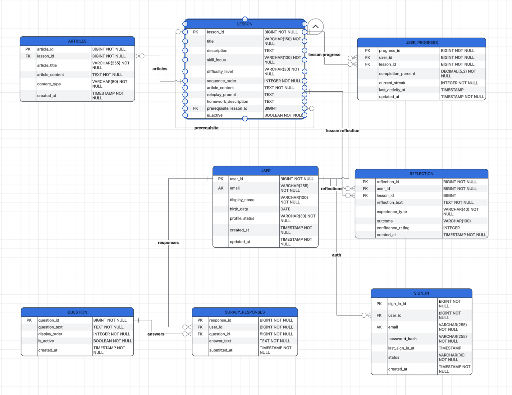

# Beanos
**App Summary:** The problem we are trying to solve is that men are struggling to get a girlfriend. This is because men don’t feel comfortable talking to women, struggle to plan fun dates, and act awkward on those dates. This prevents the relationship from growing into a second date and onward. This creates a negative-feedback loop where even if a guy talks himself into approaching a girl, he has built-up anxiety that prevents him from getting anything other than a rejection, further feeding into his anxiety and reluctance to try again. The app has a lesson format to teach these skills that men lack, leading to men finding a girlfriend.

**ERD:** 

**Tech Stack:** HTML/CSS/JavaScript, Node.Js, Supabase. This fits our team because our product is going to be web-based, and our group is most comfortable with the HTML/JS platform. 

**How to Get It Running:**
1. In this GitHub repository, navigate to the green "Code" button
2. In the drop down menu, select "Download Zip"
3. Open the .zip file and click on "Index.html" to open the file in your browser
    a. If this doesn't work, right-click the file and select "Open with" and select your browser

**Verifying the Vertical Slice:**
1. Enter `testemail@gmail.com` into the email field, and ‘testpassword’ and click the “Register” button. 
2. Ensure the UI updates dynamically to show `"User saved to database successfully!"`. 
3. Refresh the browser (`Command/Control + r`). Verify that `"Test Entry"` is still displayed after the reload.
